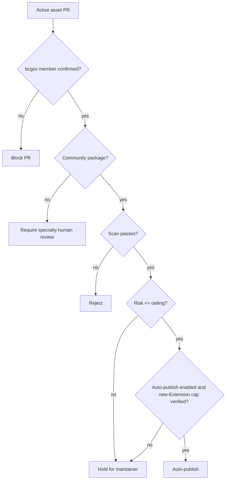

# Community intake policy

Contributors to any active asset type must be members of the GitHub `bcgov`
organization. This is the marketplace's eligibility proxy, not proof of
employment. The public catalog remains readable by everyone.

The `community` namespace accepts all four active asset types. Community
packages can publish on automated checks alone and are labeled
**Auto-checked**, never "Reviewed". Specialty packages require human review of
the exact package revision.

Because nobody reviews community content by hand, the automated intake gate is
the only thing standing between the marketplace and a bad day. This document
explains, in plain terms, what that gate does and why.

## The risk we are defending against

> A brand-new account, or a real account that has been taken over, opens a burst
> of pull requests that add malicious or junk skills to the community namespace
> faster than anyone notices.

One clever skill slipping through is bad. A *flood* of them is worse, because it
buries the signal and wastes reviewer attention. The gate is designed to make
that flood expensive and slow, without adding friction for trusted contributors
doing ordinary work.

## Defence in depth

Each layer catches something the others miss. Organization membership is a
hard eligibility gate for every active asset PR. Community PRs then pass
additional anti-abuse controls before they may auto-publish.

| # | Layer | What it stops | Where it lives |
|---|-------|---------------|----------------|
| 1 | **Fork gate** | Untrusted code from forks; CI never runs on or grants a token to a fork PR. | `.github/workflows/pr.yml` |
| 2 | **Deterministic scan** | Secrets, hidden Unicode, undeclared network/scripts, blocked file types, tampering. Blocking findings stop publication outright. | `scripts/marketplace.py` (`scan_package`) |
| 3 | **Capability risk band** | Over-broad permissions. Wildcard capabilities (`*`), secrets combined with commands or network, or `RESTRICTED` data all raise the band to **high**, which cannot auto-publish. | `capability_risk()` |
| 4 | **Contributor eligibility** | Authors who are not confirmed members of the `bcgov` organization. Applies to every active asset type. | `community-intake.yml` |
| 5 | **New-Extension cap** | Bursts of new packages: at most 10 per author in a rolling 7-day window. Until this signal is implemented and verified, auto-publish stays off. | `config/marketplace.yaml` |

## The decision, in one sentence

Every active asset PR requires confirmed `bcgov` membership. A community
submission is **held for review** while `auto-publish: false`. A blocking scan
finding **rejects** it. Enabling auto-publish requires the scan, capability
risk, and rolling new-Extension cap to be enforced.



The community auto-publish decision is a pure, tested function
(`intake_decision` in `scripts/marketplace.py`). If the workflow cannot resolve
the new-Extension velocity, the package is held, never auto-published.
If membership cannot be confirmed, the contributor-eligibility check fails and
blocks the PR.

## The knobs (config/marketplace.yaml)

```yaml
community-intake:
  max-new-packages-per-window: 10
  window-days: 7
  auto-publish-risk-ceiling: elevated  # low | elevated | high
  auto-publish: false
```

The cap is measured over a rolling window, not by counting open PRs.
Auto-publish remains disabled until its enforcement is available. The risk
ceiling does not override the disabled flag.

## Honest limitations

- **Membership follows GitHub's author association.** The workflow accepts only
  pull requests GitHub identifies with `author_association: MEMBER`; other
  associations fail closed. This uses GitHub's pull-request event metadata and
  does not require an organization-readable token or additional repository
  secret.
- **Velocity is not yet resolved.** The workflow returns an unknown velocity
  signal and holds submissions rather than publishing without a working cap.
- **This gate governs new submissions only.** Skills already in the tree are shown
  with their `Auto-checked` label and their capability-risk chip so a reader can
  judge them directly; the gate does not retroactively remove them.

## Tradeoffs and alternatives considered

- **Human-review everything (rejected):** highest assurance, but it does not scale
  to an open community namespace and defeats the "put anything here" goal.
- **Scan-only, no author gate (rejected):** lowest friction, but leaves the flood
  scenario wide open — a scan cannot tell a trusted author from a throwaway account.
- **Membership gate + community risk ceiling + velocity (chosen):** eligible
  contributors can publish low-risk community assets quickly; risky or
  high-volume activity slows down to human review. Membership is a hard
  contributor gate for every active asset type.
