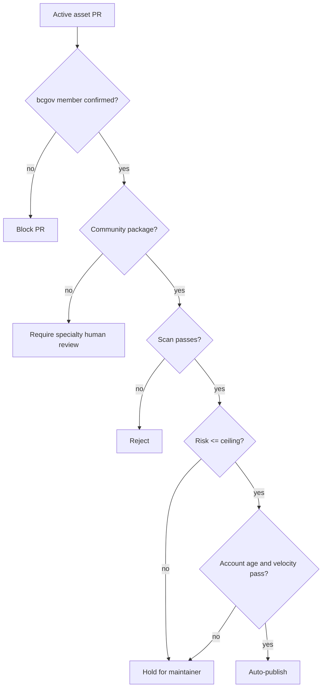

# Community intake policy

Contributors to any active asset type must be members of the GitHub `bcgov`
organization. This is the marketplace's eligibility proxy, not proof of
employment. The public catalog remains readable by everyone.

The `community` namespace accepts all four active asset types. Community
packages can publish on automated checks alone and are labeled
**Auto-checked**, never "Reviewed". Specialty packages require human review of
the exact package revision.

Because nobody reviews community content by hand, the automated intake gate is
the only thing standing between the marketplace and a bad day. This document
explains, in plain terms, what that gate does and why.

## The risk we are defending against

> A brand-new account, or a real account that has been taken over, opens a burst
> of pull requests that add malicious or junk skills to the community namespace
> faster than anyone notices.

One clever skill slipping through is bad. A *flood* of them is worse, because it
buries the signal and wastes reviewer attention. The gate is designed to make
that flood expensive and slow, without adding friction for trusted contributors
doing ordinary work.

## Defence in depth: five independent layers

Each layer catches something the others miss. Organization membership is a
hard eligibility gate for every active asset PR. Community PRs then pass
additional anti-abuse controls before they may auto-publish.

| # | Layer | What it stops | Where it lives |
|---|-------|---------------|----------------|
| 1 | **Fork gate** | Untrusted code from forks; CI never runs on or grants a token to a fork PR. | `.github/workflows/pr.yml` |
| 2 | **Deterministic scan** | Secrets, hidden Unicode, undeclared network/scripts, blocked file types, tampering. Blocking findings stop publication outright. | `scripts/marketplace.py` (`scan_package`) |
| 3 | **Capability risk band** | Over-broad permissions. Wildcard capabilities (`*`), secrets combined with commands or network, or `RESTRICTED` data all raise the band to **high**, which cannot auto-publish. | `capability_risk()` |
| 4 | **Contributor eligibility** | Authors who are not confirmed members of the `bcgov` organization. Applies to every active asset type. | `community-intake.yml` |
| 5 | **Community account-age check** | Brand-new or compromised accounts. Account age is a proxy, not org-join tenure. Failing the threshold holds community auto-publish for a maintainer. | `community-intake.yml` + config |
| 6 | **Velocity cap** | Bursts. One author may only have a few community submissions open at once. Exceeding the cap holds the extra ones for a human. | `community-intake.yml` + config |

## The decision, in one sentence

Every active asset PR requires confirmed `bcgov` membership. A community
submission **auto-publishes** only when the scan passes **and** its capability
risk is at or below the configured ceiling **and** the author's account-age and
velocity checks pass. A community submission that misses those auto-publish
checks is **held for a maintainer**; a blocking scan finding **rejects** it.



The community auto-publish decision is a pure, tested function
(`intake_decision` in `scripts/marketplace.py`). If the workflow cannot resolve
the author's account age or velocity, the package is held, never auto-published.
If membership cannot be confirmed, the contributor-eligibility check fails and
blocks the PR.

## The knobs (config/marketplace.yaml)

```yaml
community-intake:
  min-account-age-days: 30          # account must be at least this old
  max-open-submissions-per-author: 3
  max-new-packages-per-window: 5
  window-days: 7
  auto-publish-risk-ceiling: elevated  # low | elevated | high
```

Raise the thresholds to loosen the gate, lower them to tighten it. The default
ceiling is `elevated`: everyday skills that run commands or reach the network can
auto-publish for a trusted author, but anything that declares a wildcard
capability (risk `high`) always waits for a person.

## Honest limitations

- **Account age is a proxy.** The public GitHub API exposes when an *account* was
  created, not when it joined the org. This threshold is only an anti-abuse
  signal for community auto-publish, not a measure of org tenure.
- **Membership checks need an org-readable token.** The workflow uses
  `ORG_READ_TOKEN`, with `github.token` as a fallback. GitHub returns `404` both
  when the author is not a member and when the token lacks permission to read
  membership, so a `404` cannot distinguish those cases by itself. For the
  workflow to confirm membership, configure the repository or organization
  Actions secret `ORG_READ_TOKEN` with a token owned by `bcgov`, organization
  `Members: read` permission (or a classic token with `read:org` scope), and
  organization approval. See GitHub's
  [membership endpoint](https://docs.github.com/en/rest/orgs/members#check-organization-membership-for-a-user)
  and
  [fine-grained token permissions](https://docs.github.com/en/rest/authentication/permissions-required-for-fine-grained-personal-access-tokens).
  A `404` blocks the PR with this ambiguity explained; other API, permission,
  expiry, SSO, or rate-limit errors are reported separately. Fix the
  token/configuration and rerun before treating a valid member as ineligible.
- **Velocity needs a token.** The workflow also searches the author's open
  repository PRs. If GitHub cannot resolve that signal, the community package
  is held rather than auto-published.
- **This gate governs new submissions only.** Skills already in the tree are shown
  with their `Auto-checked` label and their capability-risk chip so a reader can
  judge them directly; the gate does not retroactively remove them.

## Tradeoffs and alternatives considered

- **Human-review everything (rejected):** highest assurance, but it does not scale
  to an open community namespace and defeats the "put anything here" goal.
- **Scan-only, no author gate (rejected):** lowest friction, but leaves the flood
  scenario wide open — a scan cannot tell a trusted author from a throwaway account.
- **Membership gate + community risk ceiling + velocity (chosen):** eligible
  contributors can publish low-risk community assets quickly; risky or
  high-volume activity slows down to human review. Membership is a hard
  contributor gate for every active asset type.
